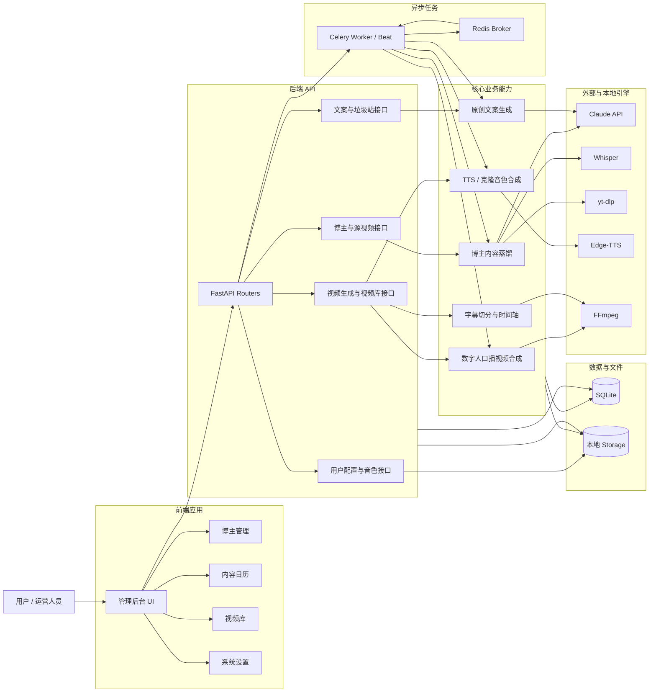
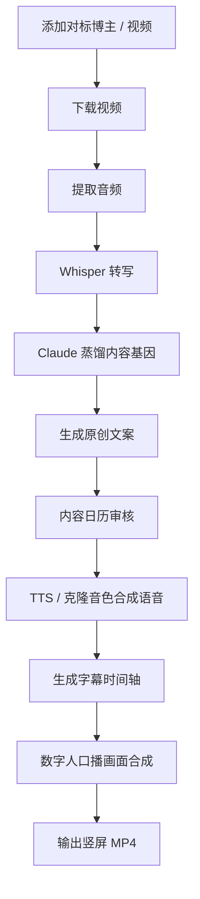

# 短视频 AI 内容工厂 · Short Video AI Factory

工程名：`short-video-ai-factory`。第一版专注 AI 科技，每天生产 3 条原创视频，为抖音、小红书、快手、哔哩哔哩准备最多 12 份发布素材包。日产量可在看板调整为 1–10 条。

## v0.2：七岗位协作工厂

| 岗位 | 职责 |
| --- | --- |
| 工厂负责人 | 从有来源的候选选题中决策、安排交接、返工、预算与交付 |
| 科技情报员 | 获取官方资料与真实演示视频，记录来源与发布时间，区分新闻和常青教程 |
| 策划编剧 | 原创口播、分镜、根据独立审核结果返工 |
| 视频制作员 | 按口播规划真实演示镜头、剪辑与标注，生成配音、字幕、封面与1080×1920成片 |
| 质量审核员 | 文案事实检查与媒体文件、编码、音量等技术检查 |
| 平台运营员 | 四平台标题、说明、标签及ZIP素材包 |
| 数据分析员 | 根据实际生产记录复盘；未接入平台指标时不推断流量表现 |

模型负责需要判断的步骤；后端控制阶段、预算、工具调用、验收和持久化。每个选题最多一次文案返工，仍未通过时负责人可为该位置更换一次备用选题；默认32次模型调用（提高产量时按目标调整上限），服务错误自动有限重试并计入预算。批次失败可以从已保存步骤继续，已完成视频不会重复生成。

首页是工厂工作台，保留 `/overview`、`/bloggers`、`/calendar`、`/videos`、`/settings` 原有功能。工厂接口位于 `/api/factory`，API文档位于 `/docs`。

**交付与发布口径**：`package_ready` 只表示素材包就绪，不表示发布成功。小红书支持官方创作后台扫码登录、上传准备、AI合成内容声明与提交回执核验。抖音、快手、B站已接入独立官方浏览器会话、登录页和通用发布任务；未经过真实账号后台核验的平台，上传和提交能力保持关闭，不能将扫码入口或接口测试视为发布已调通。`prepared` 表示已上传待提交，`submitted` 表示平台确认接收，最终公开状态仍以平台审核为准。素材包包含MP4、音频、字幕、封面、脚本和各平台元数据。

**声音与画面**：默认使用 `tech_montage` 科技演示混剪。从已引用官方页面采集真实动态素材，制作员按口播选择镜头，输出竖屏剪辑、重点标注、字幕和来源说明。至少需要3份独立动态素材；不足时该条停止制作，不会静默改用文字卡片。旧版 `cards` 可在设置中明确选择。官方演示与自制示意画面分别标注，不宣称为本工程亲测。

配音优先尝试 Edge-TTS；不可用时使用本机 CosyVoice2 自带参考音色，返回实际 `tts_engine`。数字、单位与部分型号使用确定性读法，较长的中英混合规格句按片段合成，字幕保留原文。镜头锚点依赖真实句子/字幕时间及文字插值，不能声称达到逐词对齐。视频质检包括音轨、编码、时长、动态帧差及素材覆盖，画面语义仍需复核。

已提交作品的新版本保存在独立 `media.preview` 中，工作台显示“新版演示混剪样片 · 未发布”；原交付文件和提交记录保留。当前质量迭代已关闭自动提交，新版样片不会自动发布。

## 当前机器部署

依赖 Python、Node、Redis、FFmpeg、Noto CJK中文字体和可用模型网关。该机器使用 `/usr/bin/python3`，避免误用其他工程的虚拟环境。模型网关配置放在 **`backend/.env`**（不提交Git，权限600）。支持 API Key 或兼容网关的 `ANTHROPIC_AUTH_TOKEN`；需要出站代理时设置 `HTTPS_PROXY`。常驻服务必须具备与交互终端一致的认证和网络配置。

```bash
npm --prefix frontend ci
npm --prefix frontend run build
/usr/bin/python3 -m pip install -r backend/requirements.txt
/usr/bin/python3 scripts/factoryctl.py install --port 3000
/usr/bin/python3 scripts/factoryctl.py start
```

生产服务在同一端口提供前端和API：`http://localhost:3000`。

```bash
/usr/bin/python3 scripts/factoryctl.py status
/usr/bin/python3 scripts/factoryctl.py restart
/usr/bin/python3 scripts/factoryctl.py stop
```

七个用户级 systemd 服务分别运行 API、Celery Worker、Celery Beat 和四个平台的浏览器连接器，日志在 `.runtime/`。小红书使用 `short-video-ai-factory-xiaohongshu.service`，另外三平台使用 `short-video-ai-factory-creator-{platform}.service`；各自拥有独立配置目录和进程组，API 或 Worker 重启不会关闭登录浏览器。`factoryctl.py install/start/stop/restart/status` 统一管理七个服务。要在退出登录后继续运行，用户级systemd需要启用linger。调度每分钟读取数据库计划，每天北京时间08:00启动；当天手动批次也计入当日计划，避免再次自动开工。队列名为 `short_video_ai_factory`。

本机旧目录 `distill-skill` 是新目录的兼容符号链接，用于保持历史素材绝对路径有效。历史数据库文件 `backend/distill.db` 继续使用，新增 `factory_*` 表；部署前备份保存在 `.runtime/backups/`。

## 内存保护

工作台显示工程进程的实际内存占用与机器可用余量。默认在工程占用达到 8 GiB、可用内存低于总量的 8%（至少保留 2 GiB），或机器出现明显内存等待时暂停启动新的生产步骤。阈值可通过 `.env.example` 中的 `FACTORY_*MEMORY*` 与 `FACTORY_MIN_AVAILABLE_*` 配置。

模型调用、语音模型加载、混剪镜头与平台任务入队前均检查内存。已经开始的步骤先收尾，不强制中断编码或正在提交的平台操作。暂停批次标记为 `paused_memory`，保留脚本、已完成成片、素材包与发布回执；定时器和断线恢复不会自行重启它，也不会越过它另开批次。内存恢复后，在该批次点击“恢复本轮”，或明确取消该批次。读取内存失败时同样停止启动新任务。此保护针对本工程的生产工作，不会终止其他工程进程。

## 开发与验证

```bash
cd backend
/usr/bin/python3 -m uvicorn main:app --reload --port 8002
# 另一个终端，backend目录
/usr/bin/python3 -m celery -A tasks.celery_app worker -l info -c 1
# 仓库根目录，另一个终端
npm --prefix frontend run dev
# 仓库根目录
/usr/bin/python3 -m pytest backend/tests -q
npm --prefix frontend run build
```

Vite的后端地址由 `VITE_API_TARGET` 配置，默认 `http://127.0.0.1:8002`。Docker Compose 中使用 `http://backend:8000`。Compose是可选部署模板；本次验证部署使用上述systemd方式。容器使用本地CosyVoice时，还需要容器内可执行的模型引擎环境，不能直接假设宿主虚拟环境可搬运。

新增核心文件：

- `backend/agents/registry.py`：七岗位职责、可用工具、提示词与四平台定义。
- `backend/services/factory_service.py`：持久化生产流程、检查点、审核、打包与复盘。
- `backend/services/factory_llm.py`：模型适配、调用预算、有限重试与用量记录。
- `backend/services/factory_research.py`：真实官方来源采集。
- `backend/services/factory_media.py`：真实语音、卡片视频、字幕及技术质检。
- `backend/services/factory_voice.py`：独立配音及原文字幕生成与缓存。
- `backend/services/factory_visuals.py`：有界采集官方动态视频、保留出处并验证真实运动。
- `backend/services/factory_montage.py`：演示混剪、镜头清单、标注与动态画面验收。
- `backend/models/factory.py`：生产设置、批次、作品、事件。
- `backend/tasks/factory_tasks.py`：常驻任务与每日计划。
- `frontend/src/pages/FactoryDashboard.jsx`：工作台与成果预览。

## 小红书连接与提交

工作台“发布渠道 → 小红书 → 扫码登录”打开真实官方登录会话。浏览器配置与命令队列保存在 `.runtime/` 私有目录；不保存平台原始密码，也不将登录凭据放入Git或素材包。

连接器异常退出由独立 systemd 服务重启，并重新检查保存的登录会话。连接器自身重启后，需要重新上传准备尚未提交的作品；已记录过提交尝试的作品继续受防重账本约束。仅更新 API 时可运行 `systemctl --user restart short-video-ai-factory-api.service`，保留当前浏览器编辑页。

成片支持“上传并准备发布 → 提交小红书”。发布前核对同一作品的标题、正文和AI合成内容声明；重复请求复用已有任务。发布点击前写入提交账本，必须取得成功页或明确回执才记录 `submitted`。只有明确记录为未尝试提交的失败可以重试；若点击后状态不明，则停止自动重发，保留待核对记录。

生产设置中的“自动提交小红书”可控制后续批次通过审核后自动提交；未登录时保留素材包并记录原因。当前上传封面使用平台的视频首帧，独立封面图片仍包含在素材包中。平台有额外验证时需要在官方页面完成。

发布API：`POST /api/factory/items/{id}/platforms/xiaohongshu/prepare`、`POST /api/factory/platform-jobs/{id}/publish`、`GET /api/factory/platform-jobs/{id}`。

## 抖音、快手与B站接入

工作台各平台的“打开扫码登录页”连接官方持久浏览器会话。二维码过期后，用户准备好扫码时点击“启动登录 / 刷新二维码”；不会定时自动重启二维码、打断正在进行的登录。官方额外验证必须在官方页面或对应 App 中完成。

三个连接器位于 `backend/services/creator_connector.py` 和 `creator_adapters/`。登录态、二维码、私有后台结构、命令队列和提交账本分别保存在 `.runtime/creator-connectors/{platform}/`，不进入Git。连接器读取部署环境中的代理配置，源码不包含代理地址和认证信息。

通用接口：`GET /api/factory/platforms/{platform}/login-state`、`POST /api/factory/platforms/{platform}/connect`、`POST /api/factory/items/{id}/platforms/{platform}/prepare`、`POST /api/factory/platform-jobs/{id}/publish`。状态包含独立的 `capabilities.login/prepare/publish`。上传和提交只有在相应真实控件核验后才启用；按作品、平台和操作分别防重，无法确认的提交不会自动重试。

## 原有博主内容蒸馏功能

下文介绍仍保留的博主管理、内容基因、旧文案与数字人展示流程；新的自动生产使用上面的工厂流程。


一个面向短视频运营的 AI 内容生产系统。系统通过分析对标博主视频，蒸馏内容风格与爆款结构，再自动生成原创口播文案、合成语音、渲染字幕，并产出适合抖音 / 小红书 / 快手的竖屏 MP4 视频。

## 系统架构总览



### 逻辑视图说明

| 逻辑模块 | 职责 |
| --- | --- |
| **前端应用** | 提供博主管理、内容日历、视频库、系统设置等操作入口 |
| **后端 API** | 对外提供 REST 接口，承接前端请求并组织业务流程 |
| **核心业务能力** | 负责内容蒸馏、文案生成、语音合成、字幕时间轴和视频合成 |
| **异步任务** | 承载下载、转写、蒸馏、TTS、视频渲染等耗时任务 |
| **外部与本地引擎** | Claude、Whisper、yt-dlp、Edge-TTS、FFmpeg 等能力提供方 |
| **数据与文件** | SQLite 保存业务元数据，本地 Storage 保存视频、音频、字幕、图片和声音样本 |

## 项目定位

本项目的目标不是简单生成一段文案，而是搭建一条完整的短视频生产流水线：

1. 添加对标博主或源视频
2. 下载视频并提取音频
3. 使用 Whisper 转写视频内容
4. 使用 Claude 蒸馏内容基因
5. 基于内容基因生成原创文案
6. 使用系统音色或克隆音色合成口播
7. 使用用户照片生成数字人口播画面
8. 渲染移动端友好的字幕
9. 输出 1080×1920 竖屏短视频

## 核心能力

- **博主内容蒸馏**：分析价值定位、爆款技巧、选题偏好和话术风格。
- **原创文案生成**：基于内容基因生成新的短视频选题和口播稿。
- **个人信息过滤**：避免复用原博主姓名、账号名、自我介绍、感谢观看等个人标识内容。
- **TTS 语音合成**：内置 Edge-TTS 中文音色，支持后续接入声音克隆引擎。
- **声音样本管理**：支持上传并保存用户声音样本，方便后续复用。
- **数字人口播视频**：使用用户照片或默认数字人形象生成口播视频画面。
- **移动端字幕渲染**：按自然停顿切分字幕，去掉字幕末尾标点，适配短视频观看体验。
- **内容日历**：管理待审核、已通过、已驳回、生成中和已生成视频的文案。
- **垃圾站机制**：不好的文案可删除到垃圾站，支持恢复、彻底删除和一键清空。
- **视频库**：查看、预览、下载已生成的视频。

## 技术栈

| 层级 | 技术 | 说明 |
| --- | --- | --- |
| 前端 | React + Vite + TailwindCSS | 管理后台、内容日历、视频库、系统设置 |
| 后端 | FastAPI + SQLAlchemy | REST API、数据模型、业务服务 |
| 异步任务 | Celery + Redis | 视频下载、转写、蒸馏、视频生成等耗时任务 |
| 数据库 | SQLite | 本地开发和单机部署使用 |
| AI 能力 | Claude API / 兼容模型网关 | 内容蒸馏与原创文案生成 |
| 语音转文字 | faster-whisper + Whisper `medium` | 本地音频转写，默认中文识别 |
| 视频下载 | yt-dlp | 下载对标视频 |
| 系统语音合成 | Edge-TTS | 中文 TTS 合成，默认 `zh-CN-XiaoxiaoNeural` |
| 克隆音色合成 | CosyVoice2 | 基于用户声音样本生成克隆口播 |
| 视频合成 | FFmpeg | 音频、画面、字幕合成为 MP4 |
| 画面生成 | Pillow + NumPy | 生成数字人展示场景 |

## 系统流程



## 架构概览

```text
frontend/
  React + Vite + TailwindCSS
  页面：Dashboard / Bloggers / ContentCalendar / VideoLibrary / Settings

backend/
  FastAPI REST API
  SQLAlchemy Models
  Celery Tasks
  Services:
    - distill_service.py
    - script_generator.py
    - tts_service.py
    - video_composer.py
    - video_downloader.py
    - whisper_service.py

storage/
  source videos
  transcripts
  generated audio
  generated videos
  user photos
  voice samples
```

## 目录结构

```text
short-video-ai-factory/
├── backend/
│   ├── main.py
│   ├── config.py
│   ├── database.py
│   ├── models/
│   ├── routers/
│   ├── services/
│   ├── tasks/
│   ├── scheduler.py
│   ├── requirements.txt
│   └── storage/
├── frontend/
│   ├── src/
│   │   ├── api/
│   │   ├── components/
│   │   ├── pages/
│   │   └── App.jsx
│   ├── package.json
│   └── vite.config.js
├── docker-compose.yml
└── README.md
```

## 数据模型

| 表 | 作用 |
| --- | --- |
| `bloggers` | 保存对标博主信息与分析状态 |
| `source_videos` | 保存源视频、音频、转写文本和元数据 |
| `blogger_content_dna` | 保存蒸馏后的内容基因 |
| `generated_scripts` | 保存生成的文案、审核状态和垃圾站状态 |
| `generated_videos` | 保存生成视频、音频、字幕和状态 |
| `user_profile` | 保存用户照片、系统音色、声音样本和视频配置 |

## API 模块

| 模块 | 主要接口 |
| --- | --- |
| 博主管理 | `GET /api/bloggers`、`POST /api/bloggers`、`POST /api/bloggers/{id}/analyze` |
| 源视频 | `POST /api/bloggers/{id}/videos`、`POST /api/videos/{id}/transcribe` |
| 文案 | `GET /api/scripts`、`PATCH /api/scripts/{id}`、`POST /api/scripts/generate` |
| 审核 | `POST /api/scripts/{id}/approve`、`POST /api/scripts/{id}/reject` |
| 垃圾站 | `DELETE /api/scripts/{id}`、`POST /api/scripts/{id}/restore`、`DELETE /api/scripts/trash/empty` |
| 视频生成 | `POST /api/scripts/{id}/generate-video`、`GET /api/videos-generated` |
| 设置 | `GET /api/settings`、`PUT /api/settings`、`POST /api/settings/upload-photo`、`POST /api/settings/upload-voice-sample` |

## 字幕设计

字幕按短视频移动端体验设计：

- 按自然停顿切分字幕。
- 逗号、分号、冒号、句号、问号、感叹号可以作为字幕停顿点。
- 顿号不作为字幕切分点，避免列表内容被切得太碎。
- 字幕显示时去掉末尾标点。
- 单条字幕保持短行展示，避免长句一次性铺满屏幕。
- 字幕时间轴来自分段 TTS 音频的真实时长，保证口播和字幕对齐。

## 开源模型与可替换引擎

| 类型 | 当前使用 | 配置位置 | 作用 | 后续替换方向 |
| --- | --- | --- | --- | --- |
| 语音转文字 | Whisper `medium` via `faster-whisper` | `backend/config.py` 的 `WHISPER_MODEL` | 对源视频音频做中文转写 | 可替换为 `small` 提速，或 `large-v3` 提升精度 |
| 系统 TTS | Edge-TTS 中文音色 | `DEFAULT_TTS_VOICE`、`GET /api/settings/tts-voices` | 提供稳定的系统配音音色 | 可替换为其他 TTS 服务或本地中文 TTS 模型 |
| 声音克隆 | CosyVoice2 | `backend/services/tts_service.py`、`backend/services/clone_tts.py`、`VOICE_CLONE_COMMAND` | 基于用户声音样本生成克隆音色 | 可替换为 GPT-SoVITS、IndexTTS 等更适合中文的高保真克隆模型 |
| 视频/音频处理 | FFmpeg | `video_composer.py`、`tts_service.py` | 音频格式转换、字幕烧录、竖屏视频合成 | 一般不替换，可按部署环境升级版本 |
| 图像处理 | Pillow + NumPy | `video_composer.py` | 生成默认数字人场景和背景画面 | 后续可替换为真实数字人、口型同步或图像生成模型 |

> 内容蒸馏与文案生成当前走 Claude API 或兼容模型网关，属于外部大模型能力，不在本地开源模型列表内。若后续要本地化，可在 `CLAUDE_MODEL` 与 API 适配层替换为本地大语言模型服务。

## 声音与数字人

系统默认使用 Edge-TTS 中文音色，也保留系统音色列表供用户选择。用户可以上传自己的声音样本，系统会将样本标准化为 24kHz、单声道 wav，并在生成克隆音色时通过 `VOICE_CLONE_COMMAND` 调用 CosyVoice2。

建议将 CosyVoice 仓库放在 `backend/engines/CosyVoice`，模型文件放在 `backend/storage/models/CosyVoice2-0.5B`。这两个目录都属于本地大文件目录，不提交到 Git。

```bash
COSYVOICE_DIR=backend/engines/CosyVoice
COSYVOICE_MODEL_DIR=backend/storage/models/CosyVoice2-0.5B
VOICE_CLONE_COMMAND='python backend/services/clone_tts.py --ref {sample_path} --text {text_file} --out {output_path}'
```

当未配置声音克隆命令时，系统会自动回退到 Edge-TTS。

## 本地运行

### 1. 后端

```bash
cd backend
python -m venv .venv
source .venv/bin/activate
pip install -r requirements.txt
uvicorn main:app --reload --port 8002
```

### 2. Celery Worker

```bash
cd backend
celery -A tasks.celery_app worker -l info -c 1
```

### 3. 前端

```bash
cd frontend
npm install
npm run dev
```

前端默认运行在：

```text
http://localhost:3000
```

后端 API 默认代理到：

```text
http://localhost:8002
```

## Docker 运行

```bash
docker compose up --build
```

服务端口：

| 服务 | 端口 |
| --- | --- |
| Frontend | `3000` |
| Backend | `8000` |
| Redis | `6379` |

## 环境变量

| 变量 | 必填 | 说明 |
| --- | --- | --- |
| `ANTHROPIC_API_KEY` | 是 | Claude API Key，用于蒸馏和文案生成 |
| `REDIS_URL` | 否 | Redis 地址，默认本地 Redis |
| `WHISPER_MODEL` | 否 | faster-whisper 模型，默认 `medium` |
| `CLAUDE_MODEL` | 否 | 内容蒸馏与文案生成使用的 Claude / 兼容模型名称 |
| `DEFAULT_TTS_VOICE` | 否 | 默认系统音色，默认 `zh-CN-XiaoxiaoNeural` |
| `COSYVOICE_DIR` | 否 | CosyVoice 本地仓库路径，建议 `backend/engines/CosyVoice` |
| `COSYVOICE_MODEL_DIR` | 否 | CosyVoice2 模型目录，建议 `backend/storage/models/CosyVoice2-0.5B` |
| `VOICE_CLONE_COMMAND` | 否 | 声音克隆命令模板 |

## 质量与安全约束

- 生成文案必须是原创内容，不照搬源视频原文。
- 蒸馏阶段只保留可泛化的方法论和表达结构。
- 不复用原博主姓名、账号名、地域身份、工作学校、家庭成员、联系方式等个人信息。
- 不生成“我是 XXX”“感谢大家观看”“关注 XXX”等容易冒充原博主的署名式表达。
- 字幕和口播必须对齐，不能出现大段字幕长时间停留。

## 验证方式

```bash
# 后端语法检查
python -m py_compile backend/routers/scripts.py

# 前端构建
npm --prefix frontend run build
```

端到端验证流程：

1. 添加博主或源视频。
2. 触发转写和蒸馏。
3. 生成原创文案。
4. 在内容日历审核文案。
5. 触发视频生成。
6. 在视频库预览或下载 MP4。

## 后续规划

- 热点选题自动抓取。
- 多博主风格融合。
- 批量视频生成。
- 更真实的数字人口型 / 唇形同步。
- 平台发布 API 对接。
- 更完整的视频质量自动检测。
