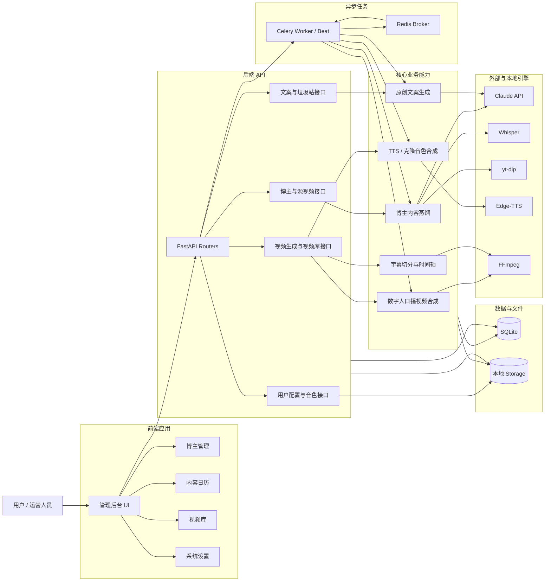
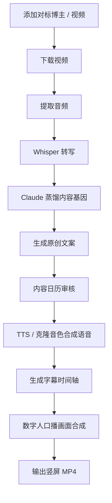

# 短视频 AI 内容工厂 · Short Video AI Factory

工程名：`short-video-ai-factory`。专注 AI 科技，每天目标 6 条约150秒原创短视频，小影、小影2、小影3各2条。每条按内容适配只分配给抖音、小红书、快手中的一个平台，每个平台每天最多2条，合计6条，不固定员工与平台。抖音按排期自动上传并选择官方AI生成声明；快手、小红书交付素材包，由用户本人使用官方客户端上传，账号自动化保持停用。账号数据自动采集保持关闭。B站单独安排每周2条6–10分钟专题，周三/周六20:00；已建立四周专题任务单，长视频制作与投稿流程仍待联调，不参与短视频队列。日产量可在看板调整为 1–6 条；发布与交付计划每个时段对应一条原创；抖音按排期发布，其他平台的具体发布时间由用户决定。

## v0.3：十位员工协作工厂

工厂员工的模型可通过 `FACTORY_MODEL_PROVIDER=anthropic|openai|codex` 切换。OpenAI 路径使用 Responses API，模型由 `FACTORY_OPENAI_MODEL` 配置（默认 `gpt-6-astra`），凭据仅存本机 `backend/.env` 的 `OPENAI_API_KEY`；启用前核实账户模型权限与 API 余额。使用订阅时选择 `codex`，由本机官方 CLI 的 ChatGPT 登录完成调用；代码不读取或转存登录令牌。每个岗位运行在独立临时目录，禁用 shell、浏览器和插件工具，仅输入所需资料并返回 JSON，不带上开发聊天。必须在受信任的本机部署，不能将 Codex 执行接口暴露给公网。默认标准速度与 low 推理；用量记录包含缓存输入，不用 API 价格估算套餐条数。不会在 GPT 失败时偷偷切回 Claude。未配置或额度不足会保留原批次；已提交的平台审核不阻塞下一条制作。已按用户要求取消每轮100万 token停止限制：`FACTORY_MAX_TOTAL_TOKENS=0` 表示不限本地累计token；仅在明确设置正数时启用该阈值。订阅服务自身限制、调用次数、返工上限和16GB内存保护仍独立执行。旧版蒸馏功能的 Claude 设置独立保留。

小探3专门向小影3交接热点、公开争议、展会和硬件资料。交接要求原始正文逐字证据、事件日期、画面需求，实际下载与分镜另行记录；只有链接不算已取得视频。新任务中，老周先给每条设计两版开场、选择一版并明确正文兑现与长期关注价值，小文写稿，小审核对答案，三位剪辑师按完整口播剪辑。管理台显示方案进度，观众留存与关注数据不足时不宣布实验胜出。


| 名字 | 岗位 | 职责 |
| --- | --- | --- |
| 老周 | 负责人 | 以真实粉丝增长为目标统一账号定位、选题与表达，分派任务、控制返工与预算 |
| 小探 | 情报员 | 追踪有证据的AI热点与公司争议，核对来源、时效，积累动态素材 |
| 小文 | 编剧 | 原创口播、开场、镜头脚本，根据审核意见修改 |
| 小影 | 视频制作员 | 完整口播逐段选镜并说明搭配理由，制作1080×1920混剪、配音、字幕与独立封面 |
| 小影2 | 视频剪辑师 | 独立制作分配的视频，重点核对论文原理、概念与演示对应 |
| 小影3 | 视频剪辑师 | 独立制作分配的视频，重点打磨热点叙事、镜头节奏与背景标注 |
| 小审 | 质量审核员 | 文案事实核对，检查音轨、字幕与编码，退回不合格作品 |
| 小麦 | 平台运营员 | 三平台文案适配、排期、提交跟进；B站长视频运营为后续任务 |
| 小数 | 数据分析员 | 以净增粉丝与关注转化为结果指标，结合完播和有效互动复盘；缺少平台数据时明确标记 |

账号默认定位为“AI热点解读者”，固定栏目为“AI热点讲明白”“看懂一个AI演示”“AI实用指南”。看板展示官方账号数据、四周增长目标、员工任务与评分依据、素材库及日报。抖音、快手采集后台近7日统计，B站采集粉丝数；小红书停止自动采集，仅保留最后一次历史数据与采集时间；只有平台确实返回的指标才展示数值，不把缺失数据填0，也不把账号整体涨粉归因给单条视频。

老周的独立运营服务每30秒巡检，每30分钟采集数据，每日22:30生成事实日报。每日任务与B站专题排期持久化在 `factory_work_orders`，按实际脚本、成片和回执更新验收进度。四周增长计划保存首次真实粉丝基线，周末使用边界前45分钟内的快照核验净增5%–10%；缺少完整周数据不判达标，零粉丝账号先追踪冷启动人数。十位员工评分满分100，但未取得证据的分项保持待评，不生成虚假总分。当前评论自动回复、逐帧画面语义抽检和单条增粉归因仍明确显示未完成。

老周按岗位将每条视频持久分配给小影、小影2或小影3；完整6条计划严格按2/2/2分配，缺素材保留缺口，不挪用其他岗位名额。每位剪辑师有独立身份、模型调用、工作事件和评分，只统计本人交付。恢复或更换选题保留负责人，已开始和已发布作品不改记到新人名下。配音和渲染仍共用受16 GiB阈值保护的生产队列，新增岗位不等于同时加载三份语音模型。

模型负责需要判断的步骤；后端控制阶段、预算、工具调用、验收和持久化。每个选题最多一次文案返工，仍未通过时负责人可为该位置更换一次备用选题；默认32次模型调用（提高产量时按目标调整上限），服务错误自动有限重试并计入预算。批次失败可以从已保存步骤继续，已完成视频不会重复生成。

首页是工厂工作台，保留 `/overview`、`/bloggers`、`/calendar`、`/videos`、`/settings` 原有功能。工厂接口位于 `/api/factory`，API文档位于 `/docs`。

**交付与发布口径**：`package_ready` 表示素材包就绪，`manual_ready` 表示已到交付时段且完整包通过验收，均不表示已发布。每条只分配一个平台；抖音按排期自动上传，快手、小红书由用户本人上传；历史 `prepared`、`submitted` 和结果不明记录保留，不自动重放。仅恢复抖音发布连接器及官方核验入口；快手、小红书、B站账号自动化继续停用。抖音使用含片头的最终交付MP4，提交前必须核验官方“内容由AI生成”声明并在正文注明制作方式。后台数据自动采集保持关闭；官方要求本人验证时暂停提示。抖音的定稿封面自动排进片头；小红书、快手在真实首帧叠加视频大标题，背景继续播放。最终MP4均包含已有钩子、关注提醒的口播字幕。用户主流程只需下载完整视频、填写标题与完整正文（包含话题及AI说明）；独立封面和ZIP为可选归档。每个包包含以完整中文标题命名的MP4、音频、字幕、封面、定稿脚本、来源，以及《发布文案》《互动回复模板》《资料来源》《手动发布说明》四份文本；工作台可查看全文或单独下载文案。文案包含标题、正文、话题、已排好文字的封面、2–3版钩子、自然关注提醒、AI制作说明、置顶评论和至少3组真实留言回复模板。不能冒充观众评论或实测经历。

**声音与画面**：默认使用 `tech_montage` 科技演示混剪。从已引用官方页面采集真实动态素材，制作员按口播选择镜头，输出竖屏剪辑、重点标注、字幕和来源说明。至少需要3份独立动态素材；不足时该条停止制作，不会静默改用文字卡片。旧版 `cards` 可在设置中明确选择。官方演示与自制示意画面分别标注，不宣称为本工程亲测。

选题前先检查对应动态素材；素材不足的来源仍保留在资料库。来源扩充到官方新闻中心和演示目录，下载过的素材按哈希复用并保留出处。制作前检查每段口播连续覆盖、素材ID和搭配理由，再由独立审核步骤核对素材描述；失败最多重排一次。此审核只验证提供的描述，不冒充成片视觉评估。抖音沿用统一SVG品牌图片片头。小红书、快手直接以本条视频的真实第一帧开场，叠加中文大标题，初始画面继续按原视频播放；小红书采用紧凑笔记文字，快手采用简洁描边大字，不插入统一品牌图片。独立封面取自导出MP4第一帧，保护原文、演示主体和口播字幕；历史包保留，新包更新下载入口。

配音优先尝试 Edge-TTS；不可用时使用本机 CosyVoice2 自带参考音色，返回实际 `tts_engine`。数字、单位与部分型号使用确定性读法，较长的中英混合规格句按片段合成，字幕保留原文。镜头锚点依赖真实句子/字幕时间及文字插值，不能声称达到逐词对齐。视频质检包括音轨、编码、时长、动态帧差及素材覆盖，画面语义仍需复核。

新短片以实际配音和成片达到目标时长±15秒为门槛，允许按实测语速改写一次。论文讲解必须取得对应真实原文，使用原文图表与经作者来源链核验的本论文演示；没有自身演示时用真实论文页讲解，不用其他研究或生成画面冒充实验。素材库保存精确来源、文件哈希和已用时间窗，原页面暂时不可用时可复用同一已引用来源的完整缓存。

经人工核验的较大官方原片可按精确来源URL和固定SHA在本机导入；目前三个已登记NVIDIA原片的本地导入预算为80MB/文件、150MB总量，普通网络下载预算不变。本机原片、缓存、登录资料和发布记录不随Git分发。

已提交作品的新版本保存在独立 `media.preview` 中，工作台显示“新版演示混剪样片 · 未发布”；原交付文件和提交记录保留。人工交付计划仅使用对应批次中通过质检的原创成片，新版样片和旧视频不会被自动拿来补量。

小影2的未发布论文视频固定使用沉稳男声（Yunyang、语速−8%、原始音调），配音缓存与成片按声线区分；服务失败时暂停该条，不回退到女声。已发布作品保留。使用 `edge-tts==7.3.1`，旧版可能因握手协议失效返回403；部署工具优先使用仓库根目录 `.venv/bin/python`，避免修改其它项目共用的Python环境。

小探的每日情报覆盖七个方向：通用大模型进化、机器人、算力基础设施、端侧芯片、AI应用、真实论文、产业动态与展会争议。每天主动寻找通用大模型更新；缺少对应一手原文或画面时记录缺口，不能把世界模型泛称为通用大模型更新，也不能把TTS适配NPU冒充芯片发布。候选验证日志保留来源ID与素材ID混用、拒绝原因、岗位计数和题材覆盖证据；纯素材不足不重复消耗选题模型调用。

经原文、抽帧和重复检查的本地素材可以通过 `verified_visual_manifest` 接入，保留准确来源链、SHA与已核验时间窗，不受默认采集器6条截断；加载器限制本工程storage目录及文件预算，普通混剪仍须3条不同原片。官方技术报告可展示真实PDF页和高亮，并搭配少量对应官方预览；必须标注“官方技术报告”，不能冒充arXiv论文、同行评审或本账号实测。

## 每日制作与人工交付

每日交付6个独立ZIP（抖音、快手、小红书各2个），每包包含中文大标题命名的完整MP4、《发布标题.txt》《正文描述.txt》《发布平台.txt》，其余文件仅供归档。ZIP命名“平台—大标题.zip”。六条为独立内容，不将一条换标题跨平台重复交付。抖音以问题和演示推进，小红书以分步笔记和判断清单展开，快手以直观例子和完整过程讲原理；这些是创作标准，不是对平台算法的断言。每日目标6条，小影、小影2、小影3各2条；抖音、快手、小红书按内容分配各最多2条，每条只分配一个平台。每日00:30启动本地选题与制作，缺原始资料或足量真实素材会保留缺口，不拼凑填满。当前建议时段为06:00、08:00、10:30、17:00、20:00、22:00，可保留每天独立的±900秒弹性；这些时间用于快手、小红书的交付安排，以及抖音自动发布；抖音只处理明确分配、质检通过且没有重复提交风险的作品。

`manual_delivery_enabled` 控制交付排期，独立于仅控制抖音自动发布的 `publish_enabled`；`auto_publish_xiaohongshu` 始终关闭。每15秒只核对本地制作与文件，完整文案和文件齐备后才标记 `manual_ready`。历史不确定提交仍提示本人去官方客户端核对，不以下载包代替成功回执。手动补齐当日错过的交付时段可用 `POST /api/factory/runs/{id}/catch-up`；不会重发结果不明的提交，也不会操作快手、小红书账号。

## 当前机器部署

依赖 Python、Node、Redis、FFmpeg、Noto CJK中文字体和可用模型网关。该机器使用 `/usr/bin/python3`，避免误用其他工程的虚拟环境。模型网关配置放在 **`backend/.env`**（不提交Git，权限600）。支持 API Key 或兼容网关的 `ANTHROPIC_AUTH_TOKEN`；需要出站代理时设置 `HTTPS_PROXY`。常驻服务必须具备与交互终端一致的认证和网络配置。

```bash
npm --prefix frontend ci
npm --prefix frontend run build
/usr/bin/python3 -m venv .venv
.venv/bin/python -m pip install -r backend/requirements.txt
/usr/bin/python3 scripts/factoryctl.py install --port 3000
/usr/bin/python3 scripts/factoryctl.py start
```

生产服务在同一端口提供前端和API：`http://localhost:3000`。

仅抖音账号服务可单独安装并启用：`.venv/bin/python scripts/install_creator_connectors.py --platform douyin`；在工作台开启“抖音自动发布”。快手、小红书与B站服务不能由此启用。

```bash
/usr/bin/python3 scripts/factoryctl.py status
/usr/bin/python3 scripts/factoryctl.py restart
/usr/bin/python3 scripts/factoryctl.py stop
```

四个核心用户级 systemd 服务运行API、Celery Worker、交付时钟与运营巡检，日志在私有 `.runtime/`。仅抖音发布连接器启用，其他账号浏览器连接器均停用。`factoryctl.py install/start/restart` 仅管理核心四项，`stop/status` 也覆盖旧连接器。退出登录后继续运行需要启用用户级systemd的linger。人工交付批次按日期生成唯一计划，队列名为 `short_video_ai_factory`。

本机旧目录 `distill-skill` 是新目录的兼容符号链接，用于保持历史素材绝对路径有效。历史数据库文件 `backend/distill.db` 继续使用，新增 `factory_*` 表；部署前备份保存在 `.runtime/backups/`。

## 内存保护

工作台显示工程进程的实际内存占用与机器可用余量。优先读取PSS；短命进程的PSS暂时不可读时，使用该进程RSS作为保守上界，已退出的进程不计入；只有进程核验失败时额外复查一次，真实内存或PSI超标仍立即暂停。默认在工程占用达到 16 GiB、可用内存低于总量的 8%（至少保留 2 GiB），或机器出现明显内存等待时暂停启动新的生产步骤。阈值可通过 `.env.example` 中的 `FACTORY_*MEMORY*` 与 `FACTORY_MIN_AVAILABLE_*` 配置。

模型调用、语音模型加载、混剪镜头与平台任务入队前均检查内存。已经开始的步骤先收尾，不强制中断编码或正在提交的平台操作。暂停批次标记为 `paused_memory`，保留脚本、已完成成片、素材包与发布回执；定时器和断线恢复不会自行重启它，也不会越过它另开批次。内存恢复后，在该批次点击“恢复本轮”，或明确取消该批次。读取内存失败时同样停止启动新任务。此保护针对本工程的生产工作，不会终止其他工程进程。

## 开发与验证

```bash
cd backend
/usr/bin/python3 -m uvicorn main:app --reload --port 8002
# 另一个终端，backend目录
/usr/bin/python3 -m celery -A tasks.celery_app worker -l info -c 1
# 仓库根目录，另一个终端
npm --prefix frontend run dev
# 仓库根目录
/usr/bin/python3 -m pytest backend/tests -q
npm --prefix frontend run build
```

Vite的后端地址由 `VITE_API_TARGET` 配置，默认 `http://127.0.0.1:8002`。Docker Compose 中使用 `http://backend:8000`。Compose是可选部署模板；本次验证部署使用上述systemd方式。容器使用本地CosyVoice时，还需要容器内可执行的模型引擎环境，不能直接假设宿主虚拟环境可搬运。

新增核心文件：

- `backend/agents/registry.py`：十位员工职责、可用工具、提示词与四平台定义。
- `backend/services/factory_service.py`：持久化生产流程、检查点、审核、打包与复盘。
- `backend/services/factory_llm.py`：模型适配、调用预算、有限重试与用量记录。
- `backend/services/factory_research.py`：真实官方来源采集。
- `backend/services/factory_media.py`：真实语音、卡片视频、字幕及技术质检。
- `backend/services/factory_voice.py`：独立配音及原文字幕生成与缓存。
- `backend/services/factory_visuals.py`：有界采集官方动态视频、保留出处并验证真实运动。
- `backend/services/factory_montage.py`：演示混剪、镜头清单、标注与动态画面验收。
- `backend/models/factory.py`：生产设置、批次、作品、事件。
- `backend/tasks/factory_tasks.py`：常驻任务与每日计划。
- `frontend/src/pages/FactoryDashboard.jsx`：工作台与成果预览。

## 抖音自动发布与两平台人工交付

每天生成6套独立完整素材，每个平台最多2条。抖音由发布服务按排期上传最终交付成片，必须勾选官方“内容由AI生成”声明并在正文说明AI制作；快手、小红书由用户下载ZIP手动发布。B站关闭账号自动化，保留长视频规划。

`factory_platform_policy.py` 只授权抖音发布链路；设置、扫码登录、环境变量与服务重启不能启用快手、小红书或B站自动化。`publish_enabled` 控制抖音排期发布，暂停时不创建新上传/提交；官方要求本人验证时使用抖音核验入口完成。`factoryctl` 的正常安装和启动只有API、Worker、Scheduler、Operations四项核心服务；stop/status仍能管理旧连接器。历史浏览器配置、回执与命令只保留在私有 `.runtime/`，不清空登录资料、不将未知提交改成成功。

登录、上传、核验及发布请求返回停用原因，旧二维码不再展示，工作台不轮询账号。历史统计保留最后采集时间与停止采集标记，缺失数据不填0。小数根据本人提供的官方统计再分析；小麦提供互动模板，由本人收到真实留言后选用。

## 原有博主内容蒸馏功能

下文介绍仍保留的博主管理、内容基因、旧文案与数字人展示流程；新的自动生产使用上面的工厂流程。


一个面向短视频运营的 AI 内容生产系统。系统通过分析对标博主视频，蒸馏内容风格与爆款结构，再自动生成原创口播文案、合成语音、渲染字幕，并产出适合抖音 / 小红书 / 快手的竖屏 MP4 视频。

## 系统架构总览



### 逻辑视图说明

| 逻辑模块 | 职责 |
| --- | --- |
| **前端应用** | 提供博主管理、内容日历、视频库、系统设置等操作入口 |
| **后端 API** | 对外提供 REST 接口，承接前端请求并组织业务流程 |
| **核心业务能力** | 负责内容蒸馏、文案生成、语音合成、字幕时间轴和视频合成 |
| **异步任务** | 承载下载、转写、蒸馏、TTS、视频渲染等耗时任务 |
| **外部与本地引擎** | Claude、Whisper、yt-dlp、Edge-TTS、FFmpeg 等能力提供方 |
| **数据与文件** | SQLite 保存业务元数据，本地 Storage 保存视频、音频、字幕、图片和声音样本 |

## 项目定位

本项目的目标不是简单生成一段文案，而是搭建一条完整的短视频生产流水线：

1. 添加对标博主或源视频
2. 下载视频并提取音频
3. 使用 Whisper 转写视频内容
4. 使用 Claude 蒸馏内容基因
5. 基于内容基因生成原创文案
6. 使用系统音色或克隆音色合成口播
7. 使用用户照片生成数字人口播画面
8. 渲染移动端友好的字幕
9. 输出 1080×1920 竖屏短视频

## 核心能力

- **博主内容蒸馏**：分析价值定位、爆款技巧、选题偏好和话术风格。
- **原创文案生成**：基于内容基因生成新的短视频选题和口播稿。
- **个人信息过滤**：避免复用原博主姓名、账号名、自我介绍、感谢观看等个人标识内容。
- **TTS 语音合成**：内置 Edge-TTS 中文音色，支持后续接入声音克隆引擎。
- **声音样本管理**：支持上传并保存用户声音样本，方便后续复用。
- **数字人口播视频**：使用用户照片或默认数字人形象生成口播视频画面。
- **移动端字幕渲染**：按自然停顿切分字幕，去掉字幕末尾标点，适配短视频观看体验。
- **内容日历**：管理待审核、已通过、已驳回、生成中和已生成视频的文案。
- **垃圾站机制**：不好的文案可删除到垃圾站，支持恢复、彻底删除和一键清空。
- **视频库**：查看、预览、下载已生成的视频。

## 技术栈

| 层级 | 技术 | 说明 |
| --- | --- | --- |
| 前端 | React + Vite + TailwindCSS | 管理后台、内容日历、视频库、系统设置 |
| 后端 | FastAPI + SQLAlchemy | REST API、数据模型、业务服务 |
| 异步任务 | Celery + Redis | 视频下载、转写、蒸馏、视频生成等耗时任务 |
| 数据库 | SQLite | 本地开发和单机部署使用 |
| AI 能力 | Claude API / 兼容模型网关 | 内容蒸馏与原创文案生成 |
| 语音转文字 | faster-whisper + Whisper `medium` | 本地音频转写，默认中文识别 |
| 视频下载 | yt-dlp | 下载对标视频 |
| 系统语音合成 | Edge-TTS | 中文 TTS 合成，默认 `zh-CN-XiaoxiaoNeural` |
| 克隆音色合成 | CosyVoice2 | 基于用户声音样本生成克隆口播 |
| 视频合成 | FFmpeg | 音频、画面、字幕合成为 MP4 |
| 画面生成 | Pillow + NumPy | 生成数字人展示场景 |

## 系统流程



## 架构概览

```text
frontend/
  React + Vite + TailwindCSS
  页面：Dashboard / Bloggers / ContentCalendar / VideoLibrary / Settings

backend/
  FastAPI REST API
  SQLAlchemy Models
  Celery Tasks
  Services:
    - distill_service.py
    - script_generator.py
    - tts_service.py
    - video_composer.py
    - video_downloader.py
    - whisper_service.py

storage/
  source videos
  transcripts
  generated audio
  generated videos
  user photos
  voice samples
```

## 目录结构

```text
short-video-ai-factory/
├── backend/
│   ├── main.py
│   ├── config.py
│   ├── database.py
│   ├── models/
│   ├── routers/
│   ├── services/
│   ├── tasks/
│   ├── scheduler.py
│   ├── requirements.txt
│   └── storage/
├── frontend/
│   ├── src/
│   │   ├── api/
│   │   ├── components/
│   │   ├── pages/
│   │   └── App.jsx
│   ├── package.json
│   └── vite.config.js
├── docker-compose.yml
└── README.md
```

## 数据模型

| 表 | 作用 |
| --- | --- |
| `bloggers` | 保存对标博主信息与分析状态 |
| `source_videos` | 保存源视频、音频、转写文本和元数据 |
| `blogger_content_dna` | 保存蒸馏后的内容基因 |
| `generated_scripts` | 保存生成的文案、审核状态和垃圾站状态 |
| `generated_videos` | 保存生成视频、音频、字幕和状态 |
| `user_profile` | 保存用户照片、系统音色、声音样本和视频配置 |

## API 模块

| 模块 | 主要接口 |
| --- | --- |
| 博主管理 | `GET /api/bloggers`、`POST /api/bloggers`、`POST /api/bloggers/{id}/analyze` |
| 源视频 | `POST /api/bloggers/{id}/videos`、`POST /api/videos/{id}/transcribe` |
| 文案 | `GET /api/scripts`、`PATCH /api/scripts/{id}`、`POST /api/scripts/generate` |
| 审核 | `POST /api/scripts/{id}/approve`、`POST /api/scripts/{id}/reject` |
| 垃圾站 | `DELETE /api/scripts/{id}`、`POST /api/scripts/{id}/restore`、`DELETE /api/scripts/trash/empty` |
| 视频生成 | `POST /api/scripts/{id}/generate-video`、`GET /api/videos-generated` |
| 设置 | `GET /api/settings`、`PUT /api/settings`、`POST /api/settings/upload-photo`、`POST /api/settings/upload-voice-sample` |

## 字幕设计

字幕按短视频移动端体验设计：

- 按自然停顿切分字幕。
- 逗号、分号、冒号、句号、问号、感叹号可以作为字幕停顿点。
- 顿号不作为字幕切分点，避免列表内容被切得太碎。
- 字幕显示时去掉末尾标点。
- 单条字幕保持短行展示，避免长句一次性铺满屏幕。
- 字幕时间轴来自分段 TTS 音频的真实时长，保证口播和字幕对齐。

## 开源模型与可替换引擎

| 类型 | 当前使用 | 配置位置 | 作用 | 后续替换方向 |
| --- | --- | --- | --- | --- |
| 语音转文字 | Whisper `medium` via `faster-whisper` | `backend/config.py` 的 `WHISPER_MODEL` | 对源视频音频做中文转写 | 可替换为 `small` 提速，或 `large-v3` 提升精度 |
| 系统 TTS | Edge-TTS 中文音色 | `DEFAULT_TTS_VOICE`、`GET /api/settings/tts-voices` | 提供稳定的系统配音音色 | 可替换为其他 TTS 服务或本地中文 TTS 模型 |
| 声音克隆 | CosyVoice2 | `backend/services/tts_service.py`、`backend/services/clone_tts.py`、`VOICE_CLONE_COMMAND` | 基于用户声音样本生成克隆音色 | 可替换为 GPT-SoVITS、IndexTTS 等更适合中文的高保真克隆模型 |
| 视频/音频处理 | FFmpeg | `video_composer.py`、`tts_service.py` | 音频格式转换、字幕烧录、竖屏视频合成 | 一般不替换，可按部署环境升级版本 |
| 图像处理 | Pillow + NumPy | `video_composer.py` | 生成默认数字人场景和背景画面 | 后续可替换为真实数字人、口型同步或图像生成模型 |

> 内容蒸馏与文案生成当前走 Claude API 或兼容模型网关，属于外部大模型能力，不在本地开源模型列表内。若后续要本地化，可在 `CLAUDE_MODEL` 与 API 适配层替换为本地大语言模型服务。

## 声音与数字人

系统默认使用 Edge-TTS 中文音色，也保留系统音色列表供用户选择。用户可以上传自己的声音样本，系统会将样本标准化为 24kHz、单声道 wav，并在生成克隆音色时通过 `VOICE_CLONE_COMMAND` 调用 CosyVoice2。

建议将 CosyVoice 仓库放在 `backend/engines/CosyVoice`，模型文件放在 `backend/storage/models/CosyVoice2-0.5B`。这两个目录都属于本地大文件目录，不提交到 Git。

```bash
COSYVOICE_DIR=backend/engines/CosyVoice
COSYVOICE_MODEL_DIR=backend/storage/models/CosyVoice2-0.5B
VOICE_CLONE_COMMAND='python backend/services/clone_tts.py --ref {sample_path} --text {text_file} --out {output_path}'
```

当未配置声音克隆命令时，系统会自动回退到 Edge-TTS。

## 本地运行

### 1. 后端

```bash
cd backend
python -m venv .venv
source .venv/bin/activate
pip install -r requirements.txt
uvicorn main:app --reload --port 8002
```

### 2. Celery Worker

```bash
cd backend
celery -A tasks.celery_app worker -l info -c 1
```

### 3. 前端

```bash
cd frontend
npm install
npm run dev
```

前端默认运行在：

```text
http://localhost:3000
```

后端 API 默认代理到：

```text
http://localhost:8002
```

## Docker 运行

```bash
docker compose up --build
```

服务端口：

| 服务 | 端口 |
| --- | --- |
| Frontend | `3000` |
| Backend | `8000` |
| Redis | `6379` |

## 环境变量

| 变量 | 必填 | 说明 |
| --- | --- | --- |
| `ANTHROPIC_API_KEY` | 是 | Claude API Key，用于蒸馏和文案生成 |
| `REDIS_URL` | 否 | Redis 地址，默认本地 Redis |
| `WHISPER_MODEL` | 否 | faster-whisper 模型，默认 `medium` |
| `CLAUDE_MODEL` | 否 | 内容蒸馏与文案生成使用的 Claude / 兼容模型名称 |
| `DEFAULT_TTS_VOICE` | 否 | 默认系统音色，默认 `zh-CN-XiaoxiaoNeural` |
| `COSYVOICE_DIR` | 否 | CosyVoice 本地仓库路径，建议 `backend/engines/CosyVoice` |
| `COSYVOICE_MODEL_DIR` | 否 | CosyVoice2 模型目录，建议 `backend/storage/models/CosyVoice2-0.5B` |
| `VOICE_CLONE_COMMAND` | 否 | 声音克隆命令模板 |

## 质量与安全约束

- 生成文案必须是原创内容，不照搬源视频原文。
- 蒸馏阶段只保留可泛化的方法论和表达结构。
- 不复用原博主姓名、账号名、地域身份、工作学校、家庭成员、联系方式等个人信息。
- 不生成“我是 XXX”“感谢大家观看”“关注 XXX”等容易冒充原博主的署名式表达。
- 字幕和口播必须对齐，不能出现大段字幕长时间停留。

## 验证方式

```bash
# 后端语法检查
python -m py_compile backend/routers/scripts.py

# 前端构建
npm --prefix frontend run build
```

端到端验证流程：

1. 添加博主或源视频。
2. 触发转写和蒸馏。
3. 生成原创文案。
4. 在内容日历审核文案。
5. 触发视频生成。
6. 在视频库预览或下载 MP4。

## 后续规划

- 热点选题自动抓取。
- 多博主风格融合。
- 批量视频生成。
- 更真实的数字人口型 / 唇形同步。
- 平台发布 API 对接。
- 更完整的视频质量自动检测。

逐条模型用量在作品卡片展开查看，按作品、制作阶段和首次/返工记录输入、输出及缓存输入；缓存输入已包含在输入总量中。批次共用选题与复盘单列，旧日志缺少作品标识的用量保留为未归属，不用整批总量除成片数冒充单条成本。工程维护对话、配音与本地渲染不包含在工厂模型调用统计内。


## 北京代理与发布暂停

用户要求抖音、快手各每日最多2条自动发布；小红书每日自动准备2个ZIP，由本人下载后手动上传。账号未取得平台发布授权时，浏览器脚本不能视为官方接口；用户知悉风险后选择继续尝试：抖音在北京代理和城市级“北京市”控件验证后按排期恢复；快手北京线路连接尚未通过，通过本机传输状态将快手排期转为手动交付，保留下载包供本人手动发布，不能据此宣称两平台均已接通。小红书账号自动化继续关闭。抖音官方公约限制未经平台允许的自动化发布：https://sf3-cdn-tos.douyinstatic.com/obj/ies-hotsoon-draft/douyin_agreement/b94d5a1e-c676-4e99-92b5-2d5e26d2568b.html 。官方接入可参考抖音开放平台“内容发布接入方案”与快手开放平台“创建视频”文档，须先取得应用权限与账号授权。

`.venv/bin/python scripts/beijing_proxy.py --install` 安装独立的用户级HTTPS隧道代理。服务只监听本机回环地址，使用私有随机凭据，拒绝私有地址、组播和非443端口；不解密TLS，不记录请求内容。代理直接使用部署主机的真实网络，必须实测出口位于中国北京后再将两个平台的代理配置写入私有运行环境；该服务不通过通用境外代理转发。代理凭据、验证记录及服务环境文件均不得提交Git。

网络出口北京、平台IP属地、作品地点标签是三个独立验证项。已验证代理出口，以及抖音官方表单的城市级“北京市”选项；仍不能宣称已有作品的“美国”已被改成北京。请求中仅保存 `requested_publication_city`，抖音在准备阶段选择官方“北京市”并在提交前重读控件，地点变化则阻止提交；快手地点标签尚未联调时继续阻止提交。不能用网络地理查询代替作品位置。快手在该出口的TLS连接尚未通过，不能静默回退到美国代理或浏览器直连。

## 重大新闻与虚构短剧

所有平台的封面主标题统一放在中上部，避开底部文案和右侧按钮。快手、小红书继续使用本条真实首帧叠加大标题；抖音保留自己的品牌片头，不把三平台做成同一张首页。首帧标题布局已独立版本化，更新只重做未发布版本，保留历史素材与回执。

小探与小探3优先核对带日期的公司重大事件，逐项记录已确认事实、未确认指控和画面缺口。采到公告但缺视频时仍生成待补素材记录，不静默漏报。部分岗位素材不足时，已核验选题可先生产；保留原每日目标与岗位上限，在计划中记录 `material_shortfall`，最终按实际数量显示部分完成。

原创面试动画可运行 `.venv/bin/python scripts/render_interview_satire.py /path/to/story.json`。脚本含 `title`、`fiction_notice`、`roles`、`sources`、`dialogue`；逐句配置 `speaker`（`hr`、`huang` 或 `narrator`）、`text`、`headline`、`shot`。使用普通合成声线、按音频振幅驱动口型、正反打与虚构招聘界面，导出1080×1920 MP4及原文时间线。它不克隆真人声音、不操作账号、不发布；虚构标识贯穿画面，现实背景须另行核对来源。成片、配音及交付包均放在忽略的存储目录，不能提交Git。
